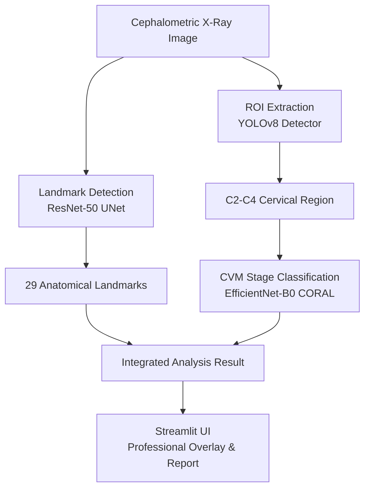
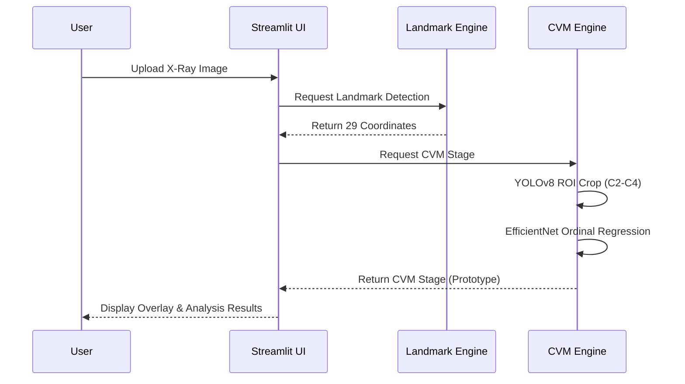
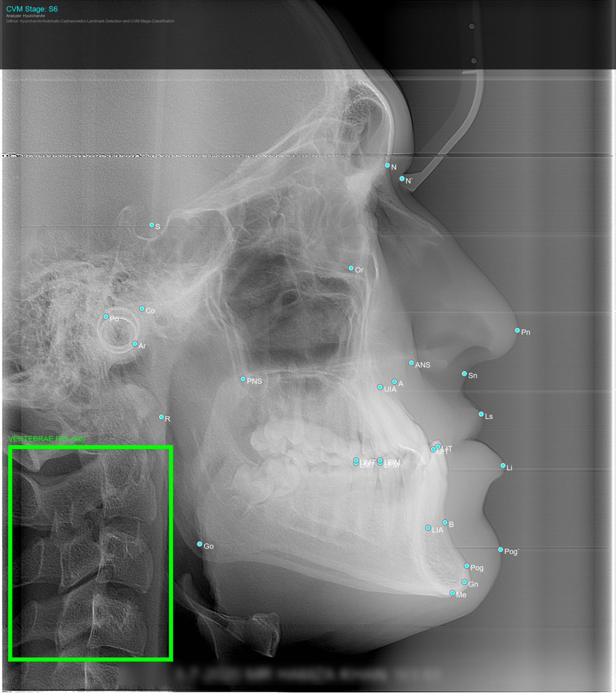
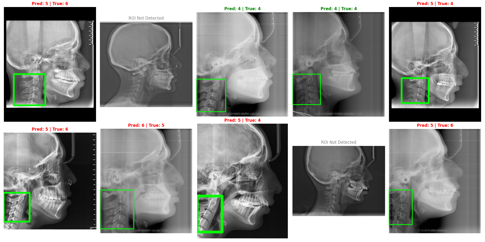

     

# Dental_001: Automatic Cephalometric Landmark Detection & CVM Stage Classification (두부계측 랜드마크 탐지 및 경추 성숙도 분류)

## 개요

본 프로젝트(`Dental_001`)는 측모 두부방사선 사진(Lateral Cephalogram)에서 고정밀 29개 해부학적 랜드마크 탐지와 경추 성숙도(CVM, Cervical Vertebral Maturation) 6단계 보조 분류를 결합한 통합 두부 계측 분석 솔루션입니다.

- [29-Landmark Localization (Production-Ready)]: ResNet-50 기반 U-Net 히트맵 회귀 및 ONNX Runtime 추론 엔진을 통해 `512x512` 정규화 좌표 그리드 기준 `MRE 3.8612 px`를 달성하여 즉시 활용 가능한 프로덕션 수준 정밀도를 제공합니다.
- [6-Stage CVM Classification (Auxiliary Research Prototype)]: YOLOv8 ROI 검출기와 EfficientNet-B0 CORAL 순서형 회귀 분류기를 결합하여 `Quadratic Weighted Kappa (QWK) 0.6123`, `Accuracy 45.05%`를 기록하였으며, 인접 단계(예: CS3-CS4, CS4-CS5) 경계의 형태학적 모호성으로 인해 단독 확진 도구가 아닌 임상 보조 연구 지표(Prototype)로 제공됩니다.
- [학습 및 추론 하드웨어 사양]:
  - CPU: AMD Ryzen 9 9900X (12-Core, 24-Threads) / Intel Core i5-14450HX
  - GPU: NVIDIA GeForce RTX 5080 (16GB GDDR7) / NVIDIA GeForce RTX 4060 Laptop GPU (8GB VRAM)
  - RAM: 16GB ~ 64GB DDR5-5600
  - OS & Stack: Windows 11, PyTorch 2.x, CUDA 12.x, YOLOv8 (Ultralytics), Albumentations, Streamlit

---

## 주요 기능 및 아키텍처

### 1. 아키텍처 및 시퀀스 다이어그램





### 2. 실시간 분석 예시 (Live Analysis Example)

<table>
<tr>
<td align="center"><b>원본 이미지 (Original)</b></td>
<td align="center"><b>분석 결과 (Analysis Result)</b></td>
</tr>
<tr>
<td></td>
<td></td>
</tr>
</table>



- 29개 해부학적 랜드마크 자동 탐지 및 라벨링
- 경추(C2-C4) ROI 자동 검출 및 CVM 성숙도 단계 보조 분류 시각화

### 3. 프로젝트 구조 (Project Structure)
- `src/`: 핵심 모델 아키텍처 및 데이터셋 처리 로직
- `checkpoints/`: 최종 학습된 AI 가중치 저장 폴더 ([가중치 다운로드 링크](https://drive.google.com/drive/folders/1ofmIOL9ZL_w3OY3db3RjqHBX28yR0hFq?usp=sharing))
- `tools/`: 분석 앱(`app.py`), 추론 스크립트(`inference.py`), FastAPI 서버(`api.py`) 등 핵심 유틸리티
- `docs/`: 개발 로그 및 시각화 자산 상세 설명서
- `scripts/`: 모델 재학습 및 성능 평가 스크립트
- `training_log/`: 훈련 지표 및 손실 곡선 기록물

### 4. 모델 가중치 (Model Weights on Hugging Face)
- [Hugging Face Repository (`chemahc94/Dental-AI-Models`)](https://huggingface.co/chemahc94/Dental-AI-Models/tree/main/Dental_001)
- [Hugging Face Repository (`chemahc94/Cephalometric-Landmark-CVM`)](https://huggingface.co/chemahc94/Cephalometric-Landmark-CVM)

| 파일명 (Filename) | 배치 경로 (Destination Path) | 비고 (Note) |
| :--- | :--- | :--- |
| `best_unet_transfer_model_512px.pth` | `checkpoints/` | [핵심] 랜드마크 탐지 V2 |
| `best_cvm_v2_768px.pth` | `checkpoints/` | [핵심] CVM 단계 분류 V2 (Prototype) |
| `cephnet_model.pth` | 프로젝트 루트 (`./`) | 구형 랜드마크 모델 (Legacy) |
| `best_mil_model.pth` | `checkpoints/` | MIL 방식 실험 모델 |

---

## 벤치마크 및 검증 성능

### 1. 랜드마크 탐지 (29-Landmark Detection - Production Ready)
- [성능]: `512x512` 정규화 좌표 그리드 기준 `MRE (Mean Radial Error) 3.8612 px` 달성
- [기술]: ResNet-50 기반 U-Net + `256x256` 고해상도 히트맵 회귀 (`512x512` 입력 스케일 복원)
- [단위 및 스케일 주의사항]:
  - `MRE 3.8612 px`는 원본 장비 해상도가 아닌 `512x512` 정규화 좌표계(Normalized Coordinate Grid) 위에서 측정된 픽셀 오차입니다.
  - 표에 병기된 임상 참조 기준 `< 4.6 px (~2.0 mm)`는 성인 측모 두부방사선 사진이 `512x512`로 리사이즈되었을 때의 공칭 스케일 팩터(`~0.43 mm/px`, 약 220mm 시야각 가정)를 적용한 근사 환산치입니다. 실제 촬영 장비마다 원본 DICOM 픽셀 간격(Pixel Spacing / ImagerPixelSpacing)이 상이하므로, 실임상 밀리미터(mm) 단위 절대 계측 시에는 반드시 장비별 DICOM 메타데이터 또는 기준자(Calibration Ruler) 스케일을 곱하여 환산해야 합니다.

### 2. CVM 단계 분류 (6-Stage CVM Classification - Auxiliary Prototype)
- [방식]: Two-Stage Pipeline (YOLOv8 Detector + EfficientNet-B0 CORAL Ordinal Classifier)
- [성능]: `Quadratic Weighted Kappa (QWK) 0.6123`, `Accuracy 45.05%`
- [임상적 한계 및 용도 안내]:
  - CVM 6단계(CS1~CS6) 분류는 연속적인 골 성숙 과정을 이산화한 특성상 인접 단계 간 경계 모호성(Adjacent-stage boundary ambiguity)과 전문의 간 판독 편차(Inter-observer variability)가 존재합니다.
  - 본 모델은 순서형 회귀(CORAL)를 통해 2단계 이상 크게 벗어나는 치명적 오분류를 억제하여 `QWK 0.6123`의 순서 일치도를 확보했으나, 단일 단계 정답률(`Accuracy 45.05%`)은 단독 임상 진단 기준으로 사용하기에 충분하지 않습니다. 따라서 CVM 출력 결과는 29개 랜드마크 계측과 함께 참고하는 보조 연구 지표(Auxiliary Research Indicator)로만 활용해야 합니다.

### 3. 정량 평가 결과 요약
| Task | Dataset | Metric | Result | Target / Reference Note |
| :--- | :--- | :--- | :--- | :--- |
| [29-Landmark Detection] | Aariz Test Set (`512x512` grid) | [MRE (px)] | `3.8612 px` | `< 4.6 px (~2.0 mm at nominal ~0.43 mm/px scale)` |
| [CVM Classification] | Aariz Valid Set (6-stage) | [QW Kappa] | `0.6123` | `> 0.60 (Ordinal agreement, Prototype)` |
| [CVM Classification] | Aariz Valid Set (6-stage) | [Accuracy] | `45.05%` | `Auxiliary research indicator (adjacent-stage ambiguity)` |

### 4. 향후 고도화 계획 (Future Roadmap)
- [CVM 분류 정밀도 극대화]: Ordinal Smoothing 도입을 통한 인접 단계 오분류 패널티 최적화 및 Soft Labeling 기반 확신도 학습 적용 (Kappa `0.70` 이상 목표)
- [예외 케이스(Edge Case) 대응력 강화]: 저품질 영상이나 해부학적 변이 케이스에서 YOLO 검출 실패 시 랜드마크 기반 통계적 ROI 추정 Fallback 구현
- [실시간 데이터 선순환 구축]: `labeling_tool.py`와 진단 앱을 통합하여 교정 데이터를 미세 조정(Fine-tuning)하는 Active Learning 파이프라인 완성

---

## 데이터셋 출처 및 라이선스

### 1. 코드 출처 및 라이선스 (MIT License)
- 본 저장소의 초기 랜드마크 데이터 로더 및 베이스라인 구조는 [manwaarkhd/aariz](https://github.com/manwaarkhd/aariz) (`MIT License`, `Copyright (c) 2023 Muhammad Anwaar Khalid`)를 기반으로 포크 및 확장되었습니다.
- 본 저장소에서 추가된 ResNet-50 U-Net 고해상도 히트맵 파이프라인, YOLOv8 + EfficientNet-B0 CORAL CVM 2단계 파이프라인, ONNX Runtime 가속 추론 모듈 및 FastAPI/Streamlit 통합 인터페이스는 `Copyright (c) 2026 Hyunchan An` 하에 동일하게 `MIT License`로 배포됩니다. 전체 전문은 [LICENSE](LICENSE) 파일을 참조하십시오.

### 2. 데이터셋 출처 및 2차 저작물 고지 (CC BY 4.0)
- [원본 데이터셋 (Aariz Cephalometric Dataset)]:
  - 출처: Khalid, Muhammad Anwaar et al., Figshare ([DOI: 10.6084/m9.figshare.22186789](https://doi.org/10.6084/m9.figshare.22186789) / [DOI: 10.6084/m9.figshare.27986417.v1](https://doi.org/10.6084/m9.figshare.27986417.v1))
  - 라이선스: Creative Commons Attribution 4.0 International (`CC BY 4.0`)
- [수정 및 재배포 데이터셋 (`Aariz_CVM_Clean`)]:
  - 저장소 내 `Aariz_CVM_Clean/` 디렉토리에 포함된 637장의 경추(C2-C4) 이미지는 원본 Aariz 데이터셋에서 경추 관심 영역(ROI)을 `512x512` 해상도로 크롭(Cropping)하고 판독 불가 및 노이즈 샘플을 정제(Cleaning)한 2차 저작물입니다.
  - 원저작자(Khalid et al.) 출처 표기 의무를 준수하며, 원본과 동일한 `CC BY 4.0` 라이선스 조건 하에 재배포됩니다.

---

## 설치 및 실행 방법

### 1. 가중치 다운로드 및 환경 설정 (`.env`)
1. 프로젝트를 클론한 후 `setup_env.py`를 실행하여 가중치를 Hugging Face에서 다운로드합니다:
   ```bash
   pip install -r requirements.txt
   pip install huggingface_hub
   python setup_env.py
   ```
2. `.env.example`을 참조하여 로컬 `.env` 파일을 구성합니다. 디바이스 설정은 `DEVICE=auto` (기본값: `cuda` -> `mps` -> `cpu` 자동 폴백) 또는 명시적 디바이스(`cuda`, `mps`, `cpu`) 지정을 지원합니다.

### 2. 웹 애플리케이션 및 Docker 실행
```bash
# 로컬 파이썬 환경에서 Streamlit 통합 도구 실행
streamlit run tools/app.py

# Docker로 즉시 실행
docker run -p 8000:8000 -p 8501:8501 ghcr.io/hyunchanan/automatic-cephalometric-landmark-detection-and-cvm-stage-classification:latest
```

### 3. 평가 재현 및 단위 테스트 실행
```bash
# 랜드마크 탐지 엔진 평가 (MRE 측정)
python scripts/evaluate.py

# CVM 분류 엔진 검증 루프
python scripts/train_classifier_v2.py

# Ruff 스타일 검사 및 Pytest 단위 테스트 실행
ruff check .
python -m pytest tests
```

---

## 참고 문헌 및 연구용 실행 주의사항

- [Aariz Dataset]: A comprehensive, benchmark dataset of lateral cephalometric radiographs. [DOI: 10.6084/m9.figshare.27986417.v1](https://doi.org/10.6084/m9.figshare.27986417.v1)
- [Upstream Repository]: Muhammad Anwaar Khalid, `manwaarkhd/aariz`, GitHub. [https://github.com/manwaarkhd/aariz](https://github.com/manwaarkhd/aariz)
- [Lee, J. Y.] (2002). Equipotential line method for magnetic resonance electrical impedance tomography. Inverse Problems, 18(4), 310. [DOI: 10.1088/0266-5611/18/4/310](https://doi.org/10.1088/0266-5611/18/4/310)
- [Lee, J. Y.] (2004). A reconstruction formula and uniqueness of conductivity in MREIT using two internal current distributions. Inverse Problems, 20(3), 012. [DOI: 10.1088/0266-5611/20/3/012](https://doi.org/10.1088/0266-5611/20/3/012)
- [가중치 백업 안내]: 오래된 이전 가중치 파일(Legacy Backups)은 `Emergency_Weights_Vault/Dental_001/Backup_Checkpoints` 폴더에 별도로 보존되어 있습니다.
- [연구용 실행 주의사항]:
  - 기본 실행 주소: `127.0.0.1` (로컬 전용)
  - 외부 공개/상용 배포 금지 및 오픈 데이터셋 외 민감 의료데이터 사용 금지
  - API 키·토큰은 환경변수로만 관리하며, 외부 접근이 필요하면 `ALLOW_EXTERNAL_ACCESS=true`로만 명시적 허용
